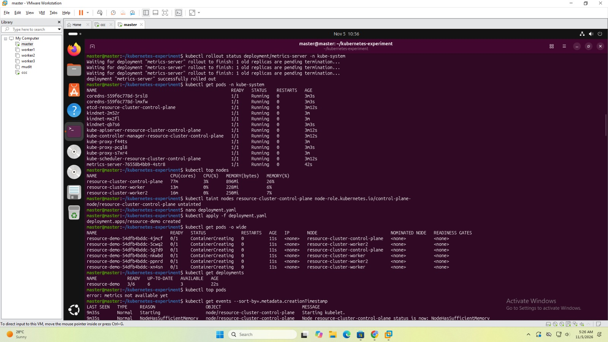
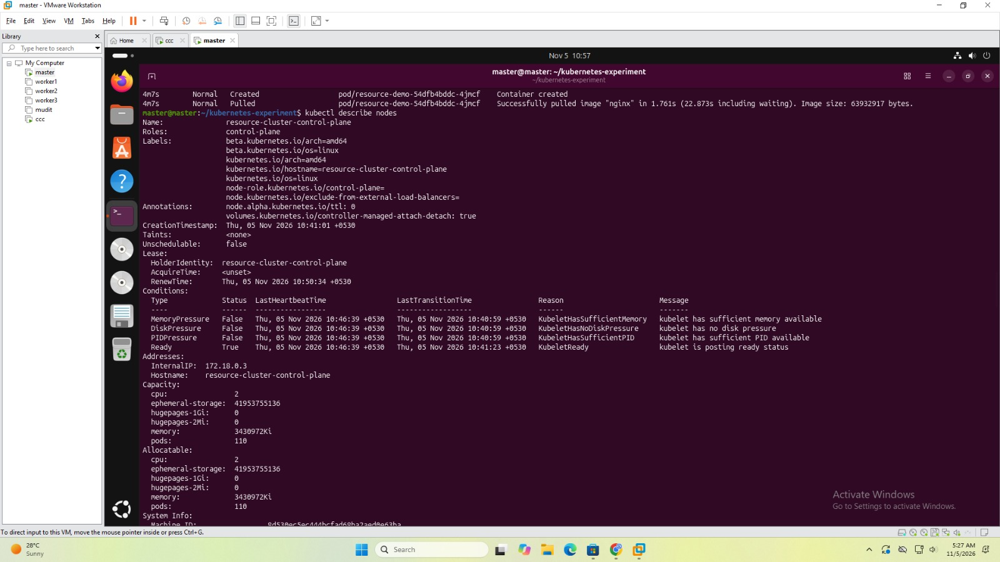
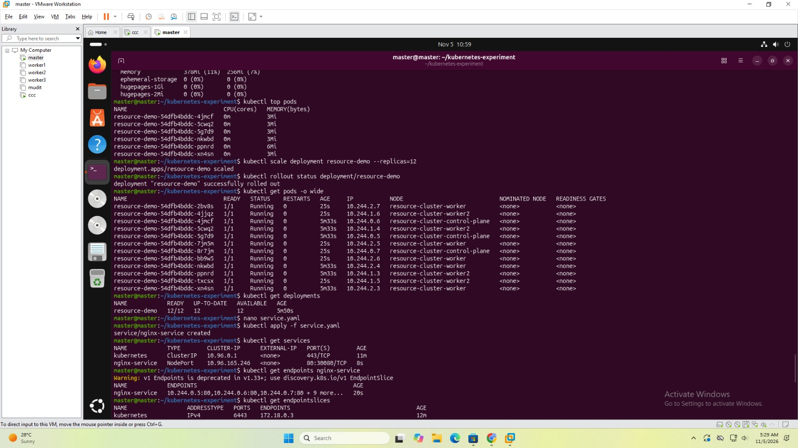
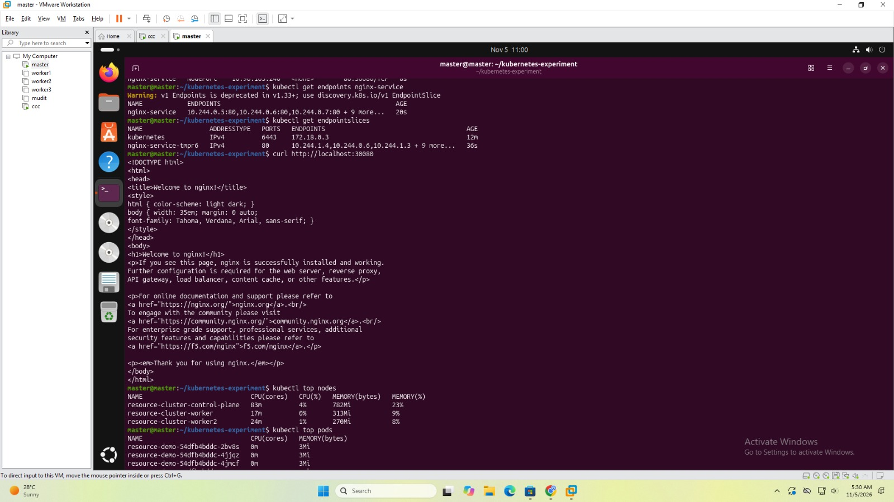
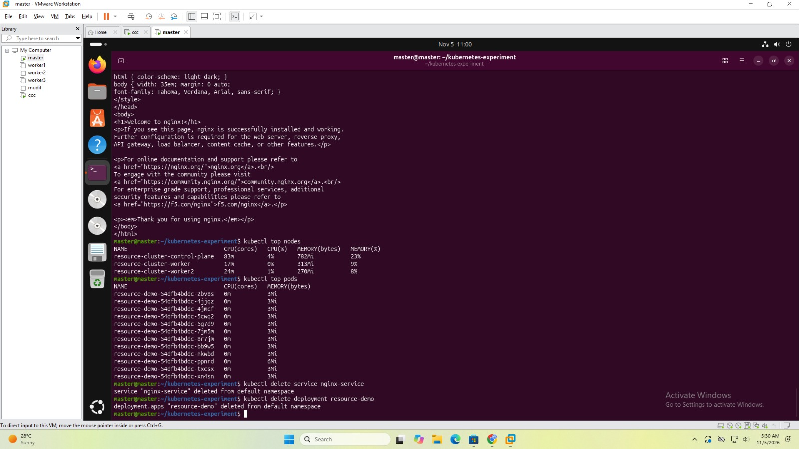

# Kubernetes: Resource Allocation, Scheduling and Load Balancing in a Three-Node Cluster

## 1. Aim

To analyze resource allocation, pod scheduling, and load balancing in a three-node Kubernetes cluster by deploying applications, configuring CPU and memory requests and limits, observing pod distribution, and testing Service-based load balancing.

## 2. Objectives

1. To create and verify a three-node Kubernetes cluster using KIND.
2. To analyze CPU and memory utilization of Kubernetes nodes using Metrics Server.
3. To deploy Nginx applications with CPU and memory requests and limits and understand pod scheduling.
4. To scale the Deployment from 6 to 12 replicas and analyze pod distribution across the three nodes.
5. To configure a NodePort Service, verify backend endpoints, test application accessibility, and monitor resource utilization.

## 3. Introduction

Kubernetes is an open-source container orchestration platform used to deploy, manage, and scale containerized applications.

In this experiment, a three-node Kubernetes cluster was created using KIND (Kubernetes IN Docker). An Nginx application was deployed with multiple replicas to understand how Kubernetes distributes workloads across nodes.

The experiment demonstrates three important concepts:

- **Resource Allocation:** Assigning CPU and memory resources to containers.
- **Pod Scheduling:** Selecting suitable nodes for running application pods.
- **Load Balancing:** Distributing incoming connections across multiple application pods through a Kubernetes Service.

## 4. Technologies and Environment

| Component | Version / Details |
|---|---|
| Operating System | Ubuntu |
| Container Platform | Docker 29.1.3 |
| Kubernetes Distribution | KIND |
| KIND Version | v0.34.0-alpha |
| Kubernetes Version | v1.37.0 |
| Container Runtime | containerd 2.3.4 |
| Application | Nginx |
| Monitoring Tool | Metrics Server |
| Configuration Language | YAML |
| Command-line Tool | kubectl |
| Cluster Name | resource-cluster |

## 5. Cluster Architecture

The experiment used a three-node Kubernetes cluster consisting of:

1. One Control Plane Node.
2. Two Worker Nodes.

### 5.1 KIND Configuration

File: `kind-config.yaml`

```yaml
kind: Cluster
apiVersion: kind.x-k8s.io/v1alpha4
nodes:
  - role: control-plane
    extraPortMappings:
      - containerPort: 30000
        hostPort: 30000
        protocol: TCP
  - role: worker
  - role: worker
```

### 5.2 Create the Cluster

```bash
kind create cluster --name resource-cluster --config kind-config.yaml --wait 5m
```

### 5.3 Cluster Creation Output

```text
Creating cluster "resource-cluster"...

Ensuring node image (kindest/node:v1.37.0)
Preparing nodes
Writing configuration
Starting control-plane
Installing CNI
Installing StorageClass
Joining worker nodes

Waiting 5s for control-plane to be Ready

Ready after 95s

Set kubectl context to "kind-resource-cluster"

You can now use your cluster with:

kubectl cluster-info --context kind-resource-cluster
```

The cluster was successfully created, and the Kubernetes context was configured.

### 5.4 Verify Cluster Nodes

Command:

```bash
kubectl get nodes -o wide
```

### Actual Cluster Details

| Node Name | Status | Role | Kubernetes Version | Internal IP |
|---|---|---|---|---|
| resource-cluster-control-plane | Ready | control-plane | v1.37.0 | 172.18.0.3 |
| resource-cluster-worker | Ready | worker | v1.37.0 | 172.18.0.4 |
| resource-cluster-worker2 | Ready | worker | v1.37.0 | 172.18.0.2 |

Additional environment information:

- OS Image: Debian GNU/Linux 13 (trixie)
- Kernel versions recorded: 7.0.0-30-generic and 7.0.0-38-generic.
- Container Runtime: containerd 2.3.4.
- External IP: None for all three nodes.

**Observation:**

All three nodes successfully entered the `Ready` state. The control plane and both worker nodes were available for running workloads.

## 6. Experiment Procedure and Implementation

### Step 1: Verify the Kubernetes Cluster

Command:

```bash
kubectl get nodes -o wide
```

**Observation:**

- Three nodes were successfully created.
- All three nodes were in the Ready state.
- One node acted as the control plane.
- Two nodes acted as worker nodes.
- The Kubernetes version was v1.37.0.

### Step 2: Analyze Available Resources

Metrics Server was used to monitor CPU and memory utilization.

Check Metrics Server:

```bash
kubectl get deployment metrics-server -n kube-system
```

Check rollout:

```bash
kubectl rollout status deployment/metrics-server -n kube-system
```

### Actual Rollout Output

```text
Waiting for deployment "metrics-server" rollout to finish:
1 old replicas are pending termination...

Waiting for deployment "metrics-server" rollout to finish:
1 old replicas are pending termination...

deployment "metrics-server" successfully rolled out
```

The Metrics Server deployment successfully rolled out after the old replica was terminated.

Verify system pods:

```bash
kubectl get pods -n kube-system
```

The following Kubernetes system components were observed:

| Component | Expected Ready Status |
|---|---|
| CoreDNS | 1/1 |
| etcd | 1/1 |
| kindnet | 1/1 |
| kube-apiserver | 1/1 |
| kube-controller-manager | 1/1 |
| kube-proxy | 1/1 |
| kube-scheduler | 1/1 |
| metrics-server | 1/1 |

The system pod output showed the Kubernetes components running, with Metrics Server also reaching 1/1 readiness.

### 6.1 Initial Resource Utilization

Command:

```bash
kubectl top nodes
```

### Actual Initial Results

| Node | CPU Usage | CPU Utilization | Memory Usage | Memory Utilization |
|---|---:|---:|---:|---:|
| resource-cluster-control-plane | 77m | 3% | 896Mi | 26% |
| resource-cluster-worker | 13m | 0% | 228Mi | 6% |
| resource-cluster-worker2 | 16m | 0% | 250Mi | 7% |

**Observation:**

- The control plane showed the highest initial CPU utilization at 3%.
- The control plane used 896Mi of memory.
- Worker 1 used 228Mi of memory.
- Worker 2 used 250Mi of memory.
- All three nodes were successfully monitored using Metrics Server.

### Step 3: Create a Deployment

A Deployment named `resource-demo` was created to run six Nginx replicas.

Before deploying the application, the control-plane scheduling taint was removed.

Command:

```bash
kubectl taint nodes resource-cluster-control-plane node-role.kubernetes.io/control-plane-
```

Actual output:

```text
node/resource-cluster-control-plane untainted
```

This allowed application pods to be scheduled on the control-plane node.

### 6.2 Deployment Configuration

File: `deployment.yaml`

```yaml
apiVersion: apps/v1
kind: Deployment
metadata:
  name: resource-demo
spec:
  replicas: 6
  selector:
    matchLabels:
      app: resource-demo
  template:
    metadata:
      labels:
        app: resource-demo
    spec:
      containers:
        - name: nginx
          image: nginx
          resources:
            requests:
              cpu: "100m"
              memory: "64Mi"
            limits:
              cpu: "200m"
              memory: "128Mi"
```

Apply Deployment:

```bash
kubectl apply -f deployment.yaml
```

Actual output:

```text
deployment.apps/resource-demo created
```

Check pods:

```bash
kubectl get pods -o wide
```

### Resource Configuration

| Resource | Request | Limit |
|---|---:|---:|
| CPU | 100m | 200m |
| Memory | 64Mi | 128Mi |

**Explanation:**

- CPU request of 100m represents 0.1 CPU core.
- CPU limit of 200m represents 0.2 CPU core.
- Memory request of 64Mi specifies the memory requirement considered during scheduling.
- Memory limit of 128Mi specifies the maximum memory allowed for the container.

**Observation:**

- Six Nginx replicas were requested.
- Initially, some pods entered the ContainerCreating state.
- Pods were assigned to the control-plane and worker nodes.
- The initial pod startup took some time.

### Step 4: Analyze Pod Scheduling

Commands:

```bash
kubectl get pods -o wide
```

```bash
kubectl get events --sort-by=.metadata.creationTimestamp
```

The `NODE` column identifies the node hosting each pod.

The events command was used to inspect Kubernetes scheduling and node-related events.

**Initial Observation:**

The initial pod output showed the following conditions:

- Pods entered the ContainerCreating state.
- Some pods initially showed 0/1 readiness.
- Pods were assigned across the three nodes.
- Kubernetes events were used to inspect node and scheduling activity.

The initial pod listing contained six replicas, but the exact per-node distribution is not reliably readable in the captured output.

### Step 5: Analyze Resource Allocation

Commands:

```bash
kubectl describe nodes
```

```bash
kubectl top pods
```

The `kubectl describe nodes` command displays:

- Node capacity.
- Allocatable CPU and memory.
- Allocated resource requests.
- Allocated resource limits.

The `kubectl top pods` command displays actual CPU and memory consumption.

**Observation:**

- Resource requests and limits were configured for Nginx.
- Pod resource consumption was monitored.
- The scheduler used resource requests when selecting nodes.
- Actual resource usage was different from configured requests and limits.

The initial pod-level output included small CPU and memory readings, but the original terminal capture does not preserve a reliable value-to-pod mapping for every replica.

### Step 6: Scale the Deployment to 12 Replicas

The Deployment was scaled from six replicas to twelve replicas.

Command:

```bash
kubectl scale deployment resource-demo --replicas=12
```

Actual output:

```text
deployment.apps/resource-demo scaled
```

Check rollout:

```bash
kubectl rollout status deployment/resource-demo
```

Actual output:

```text
deployment "resource-demo" successfully rolled out
```

Verify pods:

```bash
kubectl get pods -o wide
```

Verify Deployment:

```bash
kubectl get deployments
```

### 6.3 Actual Scaling Result

```text
NAME           READY   UP-TO-DATE   AVAILABLE
resource-demo  12/12   12           12
```

All twelve replicas became ready and available.

### 6.4 Final Pod Distribution

Based on the recorded pod names and NODE column:

| Node | Number of Pods |
|---|---:|
| resource-cluster-control-plane | 3 |
| resource-cluster-worker | 5 |
| resource-cluster-worker2 | 4 |
| **Total** | **12** |

**Observation:**

- Initial replicas: 6.
- Final replicas: 12.
- Additional replicas created: 6.
- Final ready replicas: 12.
- Final available replicas: 12.
- All three nodes hosted Nginx pods.

This demonstrates how Kubernetes schedules additional replicas across the available nodes.

### Step 7: Create a Kubernetes Service for Load Balancing

A NodePort Service was created to expose the Nginx application.

File: `service.yaml`

The configuration specified in the practical manual is:

```yaml
apiVersion: v1
kind: Service
metadata:
  name: nginx-service
spec:
  type: NodePort
  selector:
    app: resource-demo
  ports:
    - port: 80
      targetPort: 80
      nodePort: 30080
```

Apply Service:

```bash
kubectl apply -f service.yaml
```

Actual output:

```text
service/nginx-service created
```

### Service Configuration Explanation

| Field | Value | Description |
|---|---|---|
| Service Name | nginx-service | Name of the Service |
| Type | NodePort | Exposes the Service through a node port |
| Selector | app: resource-demo | Identifies application pods |
| Port | 80 | Service port |
| Target Port | 80 | Nginx container port |
| NodePort | 30080 | Port specified in the practical manual |

The Service provides a common network endpoint for accessing the Nginx pods.

### Step 8: Verify Load-Balancing Endpoints

Commands:

```bash
kubectl get services
```

```bash
kubectl get endpoints nginx-service
```

```bash
kubectl get endpointslices
```

### 6.5 Actual Service Output

| Field | Recorded Value |
|---|---|
| Service Name | nginx-service |
| Service Type | NodePort |
| Cluster IP | 10.96.165.246 |
| Service Port | 80 |
| Displayed NodePort | 30090 |
| Target Port | 80 |
| Service Age | Approximately 20 seconds |

The actual output showed:

```text
nginx-service   NodePort   10.96.165.246   <none>   80:30090/TCP
```

### 6.6 Endpoint Verification

The endpoint command displayed:

```text
nginx-service

10.244.0.5:80, 10.244.0.6:80, 10.244.6.7:80
+ 9 more...
```

The EndpointSlice output showed:

```text
NAME                  ADDRESSTYPE   PORTS   ENDPOINTS
nginx-service-...     IPv4          80      10.244.1.4,
                                            10.244.6.6,
                                            10.244.1.3
                                            9 more...
```

The output indicated twelve registered backend endpoints.

**Observation:**

- The NodePort Service was successfully created.
- The Service selected Nginx application pods.
- Twelve backend endpoints were registered.
- EndpointSlices displayed the addresses of the backend pods.
- Kubernetes used the Service to forward connections to available endpoints.

Note: The older Endpoints API displayed a deprecation warning because Kubernetes v1.33 and later recommends EndpointSlices.

### Step 9: Test the Nginx Application

The Nginx application was tested using curl.

Command recorded during the experiment:

```bash
curl http://localhost:30088
```

### 6.7 Actual Application Response

```html
<!DOCTYPE html>
<html>
<head>
<title>Welcome to nginx!</title>
</head>

<body>
<h1>Welcome to nginx!</h1>

<p>
If you see this page, nginx is successfully installed
and working. Further configuration is required for
the web server, reverse proxy, API gateway, load balancer,
content cache, or other features.
</p>

<a href="https://nginx.org/">nginx.org</a>

<p>
<em>Thank you for using nginx.</em>
</p>
</body>
</html>
```

**Observation:**

- The curl command returned an HTML response.
- The Nginx welcome page was successfully displayed.
- The web server was accessible through the tested localhost port.

**Port discrepancy:** The KIND configuration shows host port 30000 mapped to container port 30000. The practical manual specifies NodePort 30080. The captured Service output shows NodePort 30090, while the curl command uses localhost:30088. These are preserved as recorded because the original configuration and port mapping need to be checked to determine the exact connection path.

### Step 10: Observe Resource Utilization After Scaling

After scaling the Deployment to twelve replicas, node and pod resource utilization was monitored again.

Commands:

```bash
kubectl top nodes
```

```bash
kubectl top pods
```

### 6.8 Actual Final Node Resource Utilization

| Node | CPU Usage | CPU Utilization | Memory Usage | Memory Utilization |
|---|---:|---:|---:|---:|
| resource-cluster-control-plane | 83m | 4% | 782Mi | 23% |
| resource-cluster-worker | 17m | 0% | 313Mi | 9% |
| resource-cluster-worker2 | 24m | 1% | 270Mi | 8% |

### 6.9 Initial vs Final Resource Comparison

| Node | Initial CPU | Final CPU | Initial CPU % | Final CPU % | Initial Memory | Final Memory | Initial Memory % | Final Memory % |
|---|---:|---:|---:|---:|---:|---:|---:|---:|
| Control Plane | 77m | 83m | 3% | 4% | 896Mi | 782Mi | 26% | 23% |
| Worker 1 | 13m | 17m | 0% | 0% | 228Mi | 313Mi | 6% | 9% |
| Worker 2 | 16m | 24m | 0% | 1% | 250Mi | 270Mi | 7% | 8% |

### 6.10 Resource Utilization Analysis

**Control Plane:**

- Initial CPU: 77m.
- Final CPU: 83m.
- Initial memory: 896Mi.
- Final memory: 782Mi.
- CPU utilization increased from 3% to 4%.
- Memory utilization decreased from 26% to 23%.

**Worker 1:**

- Initial CPU: 13m.
- Final CPU: 17m.
- Initial memory: 228Mi.
- Final memory: 313Mi.
- CPU utilization remained at 0% when displayed as a whole percentage.
- Memory utilization increased from 6% to 9%.

**Worker 2:**

- Initial CPU: 16m.
- Final CPU: 24m.
- Initial memory: 250Mi.
- Final memory: 270Mi.
- CPU utilization increased from 0% to 1%.
- Memory utilization increased from 7% to 8%.

**Observation:**

- CPU usage increased slightly on all three nodes.
- Both worker nodes showed an increase in memory consumption.
- Control-plane memory usage decreased in the recorded measurements.
- All three nodes continued to host application pods.

These are actual measurements captured at different points in time. They are not expected to increase uniformly because resource usage can fluctuate.

### 6.11 Pod Resource Monitoring

Command:

```bash
kubectl top pods
```

This command was executed after scaling to twelve replicas.

The output listed the twelve `resource-demo` pods and their CPU and memory consumption.

The individual pod measurements in the supplied terminal capture are partially corrupted and cannot be reliably assigned to every pod. Therefore, no additional individual pod values are assumed.

### Step 11: Clean Up Kubernetes Resources

After completing the experiment, the application resources were deleted.

Delete the Service:

```bash
kubectl delete service nginx-service
```

Actual output:

```text
service "nginx-service" deleted from default namespace
```

Delete the Deployment:

```bash
kubectl delete deployment resource-demo
```

Actual output:

```text
deployment.apps "resource-demo" deleted from default namespace
```

**Observation:**

- The Nginx Service was successfully deleted.
- The Deployment was successfully deleted.
- Associated application pods were removed.
- The three-node Kubernetes cluster remained intact.

## 7. Complete Observation Table

| Experiment | Actual Observation |
|---|---|
| Cluster Creation | KIND cluster `resource-cluster` created successfully. |
| Cluster Verification | 3 nodes in Ready state. |
| Kubernetes Version | v1.37.0 |
| Container Runtime | containerd 2.3.4 |
| Metrics Server | Successfully rolled out. |
| Initial Control Plane Usage | 77m CPU, 896Mi memory, 3% CPU, 26% memory. |
| Initial Worker 1 Usage | 13m CPU, 228Mi memory, 0% CPU, 6% memory. |
| Initial Worker 2 Usage | 16m CPU, 250Mi memory, 0% CPU, 7% memory. |
| Initial Deployment | 6 Nginx replicas. |
| CPU Request | 100m |
| CPU Limit | 200m |
| Memory Request | 64Mi |
| Memory Limit | 128Mi |
| Final Deployment | 12 replicas, 12/12 ready and available. |
| Control Plane Pod Count | 3 |
| Worker 1 Pod Count | 5 |
| Worker 2 Pod Count | 4 |
| Service Type | NodePort |
| Service Cluster IP | 10.96.165.246 |
| Displayed NodePort | 30090 |
| Service Port | 80 |
| Target Port | 80 |
| Backend Endpoints | 12 |
| Application Testing | Nginx welcome page returned successfully. |
| Final Control Plane Usage | 83m CPU, 782Mi memory, 4% CPU, 23% memory. |
| Final Worker 1 Usage | 17m CPU, 313Mi memory, 0% CPU, 9% memory. |
| Final Worker 2 Usage | 24m CPU, 270Mi memory, 1% CPU, 8% memory. |
| Cleanup | Service and Deployment successfully deleted. |

## 8. Important Kubernetes Concepts

### 8.1 Resource Requests

A resource request specifies the amount of CPU or memory required by a container for scheduling purposes.

Example:

```yaml
requests:
  cpu: "100m"
  memory: "64Mi"
```

### 8.2 Resource Limits

A resource limit defines the maximum CPU or memory a container is allowed to consume.

Example:

```yaml
limits:
  cpu: "200m"
  memory: "128Mi"
```

### 8.3 Pod Scheduling

Pod scheduling is the process of selecting a suitable node for running a pod.

The Kubernetes scheduler considers available resources, resource requests, node conditions, and scheduling constraints.

### 8.4 Deployment Scaling

Scaling changes the number of replicas in a Deployment.

In this experiment, the replicas were increased from 6 to 12.

```bash
kubectl scale deployment resource-demo --replicas=12
```

### 8.5 Kubernetes Service

A Service provides a stable network endpoint to access a group of pods.

It uses labels and selectors to identify backend pods.

### 8.6 Load Balancing

Kubernetes Services forward connections to available backend endpoints.

This allows multiple application pods to serve incoming connections through a common Service.

Load balancing does not guarantee exactly equal request counts for every pod.

### 8.7 Metrics Server

Metrics Server collects CPU and memory utilization information from nodes and pods.

Commands:

```bash
kubectl top nodes
kubectl top pods
```

## 9. Result

The experiment successfully demonstrated resource allocation, pod scheduling, Deployment scaling, and Service-based load balancing in a three-node Kubernetes cluster.

A six-replica Nginx Deployment was created and subsequently scaled to twelve replicas. All twelve replicas became ready and were distributed across the control-plane and two worker nodes.

A NodePort Service was created, and its backend endpoints were verified. The Nginx application returned its welcome page during testing.

CPU and memory utilization were monitored before and after scaling. Finally, the Service and Deployment were successfully deleted.

## Screenshots

<p align="center">
  
  
  
  
  
</p>

## 10. Conclusion

This experiment provided practical understanding of how Kubernetes manages containerized applications in a multi-node cluster.

It demonstrated how resource requests and limits are configured, how the Kubernetes scheduler assigns pods to nodes, how Deployments support scaling, and how Services provide access to multiple application pods.

The experiment also demonstrated how Metrics Server can be used to monitor CPU and memory consumption across nodes and pods.

## 11. Commands Reference

| Purpose | Command |
|---|---|
| Create KIND cluster | `kind create cluster --name resource-cluster --config kind-config.yaml --wait 5m` |
| View nodes | `kubectl get nodes -o wide` |
| Check Metrics Server | `kubectl get deployment metrics-server -n kube-system` |
| Check Metrics rollout | `kubectl rollout status deployment/metrics-server -n kube-system` |
| View system pods | `kubectl get pods -n kube-system` |
| Monitor node resources | `kubectl top nodes` |
| Remove control-plane taint | `kubectl taint nodes resource-cluster-control-plane node-role.kubernetes.io/control-plane-` |
| Apply Deployment | `kubectl apply -f deployment.yaml` |
| View application pods | `kubectl get pods -o wide` |
| View scheduling events | `kubectl get events --sort-by=.metadata.creationTimestamp` |
| Describe nodes | `kubectl describe nodes` |
| Monitor pod resources | `kubectl top pods` |
| Scale Deployment | `kubectl scale deployment resource-demo --replicas=12` |
| Check Deployment rollout | `kubectl rollout status deployment/resource-demo` |
| View Deployment | `kubectl get deployments` |
| Apply Service | `kubectl apply -f service.yaml` |
| View Services | `kubectl get services` |
| View endpoints | `kubectl get endpoints nginx-service` |
| View EndpointSlices | `kubectl get endpointslices` |
| Test Nginx | `curl http://localhost:30088` |
| Delete Service | `kubectl delete service nginx-service` |
| Delete Deployment | `kubectl delete deployment resource-demo` |

